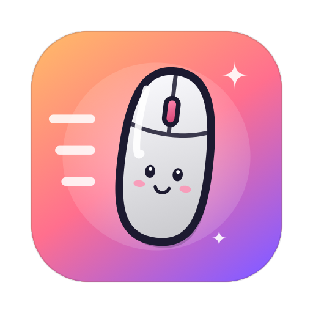
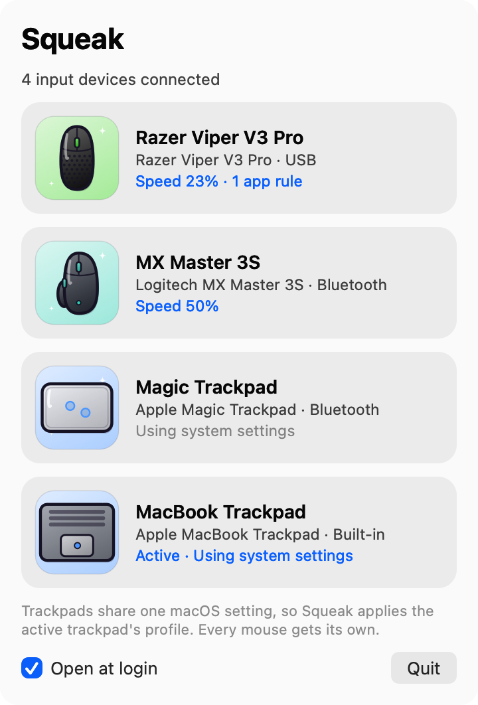
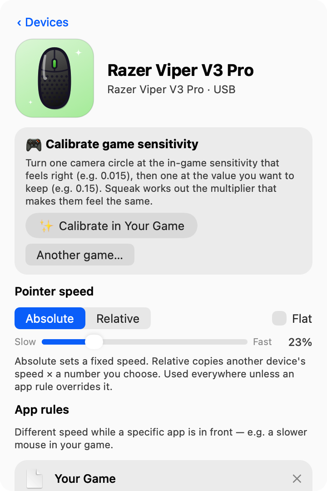
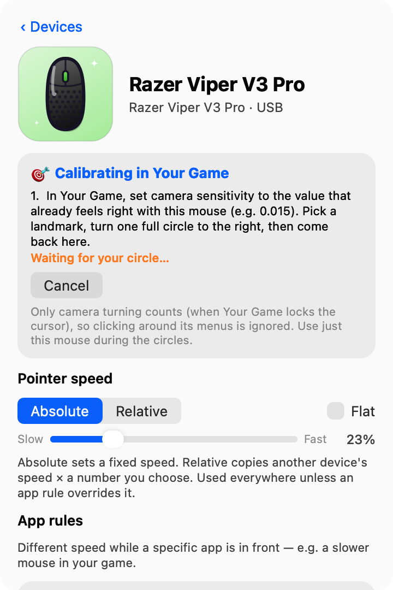
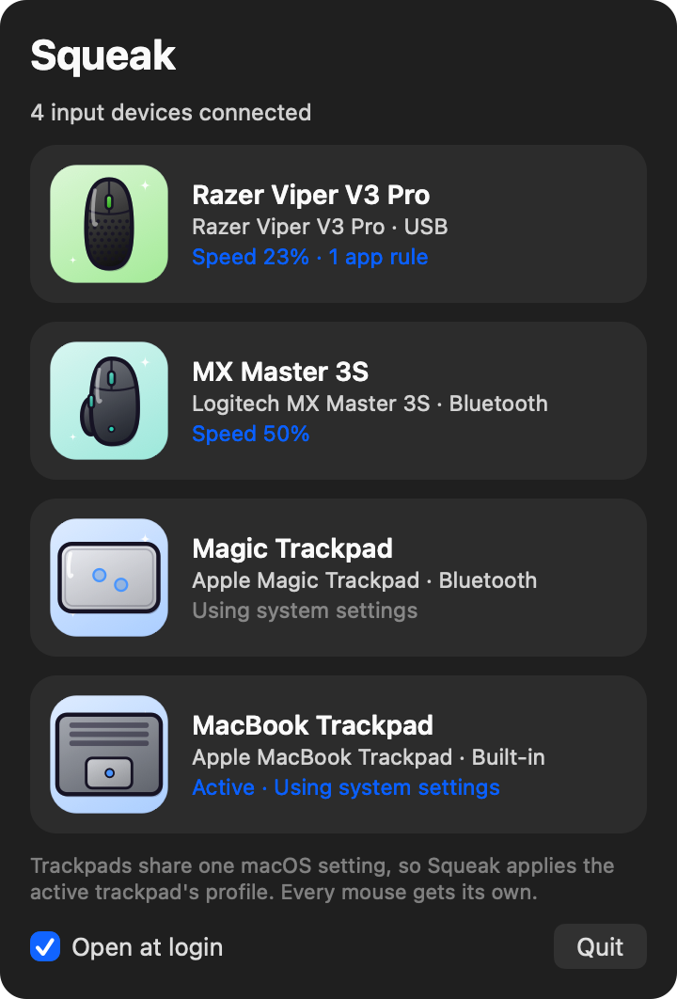
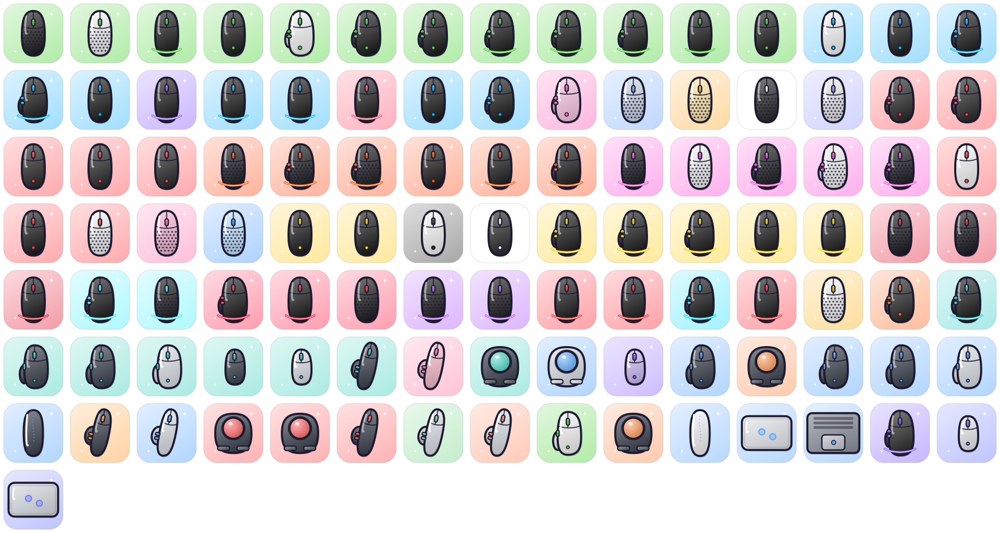

<p align="center"></p>

<h1 align="center">Squeak</h1>

<p align="center"><b>Mouse &amp; trackpad sensitivity for macOS — per device, per app, calibrated to your game.</b><br>
A tiny menu-bar app: about 18 MB of memory, 0% CPU while idle, no dependencies.</p>

<p align="center"><a href="https://github.com/Ranbo-codez/Squeak/releases/latest/download/Squeak.dmg"><b>⬇ Download Squeak.dmg</b></a> · macOS 13+ · Apple silicon &amp; Intel</p>

<p align="center">
  
  
</p>

## Why

macOS has one speed for "the mouse" and one for "the trackpad", and games only have one sensitivity setting.
So if you play with a high-DPI gaming mouse *and* sometimes a trackpad, you keep digging through settings
every time you switch. Squeak fixes that:

- **Every mouse gets its own speed.** Plug in your gaming mouse and your work mouse; each keeps its own setting.
- **App rules.** A different speed (or multiplier) automatically while a particular app or game is in front.
- **Exact in-game multiplier.** Scales the movement a game reads, for example its camera, without touching the
  cursor. ×0.1 = as if you'd divided the game's sensitivity by 10.
- **Game calibration.** Turn one camera circle at the sensitivity that already feels right, and one at the value
  you want to keep. Squeak works out the multiplier that makes them feel the same.
- **Relative speeds.** Set a device to "0.5× my trackpad" (or any device) and it follows when that one changes.
- **100+ cartoon icons.** Popular gaming and ergonomic mice are recognised and get their own icon as you connect them.
- **Starts at login** if you want it to, and puts your original speeds back when you quit.

## Install

1. [Download Squeak.dmg](https://github.com/Ranbo-codez/Squeak/releases/latest/download/Squeak.dmg), open it
   and drag **Squeak** to **Applications**.
2. Open it. Squeak isn't notarised by Apple (that needs a paid developer account), so the first time macOS says
   it can't verify it: open **System Settings → Privacy & Security**, scroll down and click **Open Anyway**.
   (Or run `xattr -dr com.apple.quarantine /Applications/Squeak.app` once.)
3. Click the mouse in your menu bar. That's it.

Prefer not to run a downloaded app? [Build it yourself](#build-it-yourself); it takes about a minute.

## Using it

- **Click a device** to set its pointer speed. **Absolute** is a fixed speed; **Relative** follows another device ×
  any number you type (0.1, 1, 10…).
- **App rules → Add app…** gives a device a different speed while that app is in front.
- **Calibrate game sensitivity** (top of each mouse's page):
  1. Click **✨ Calibrate in your game…** and pick the game (open it first).
  2. In the game, set the sensitivity that already feels right with this mouse, then turn one full circle back to a
     landmark. Return to Squeak and click **Next**.
  3. Set the sensitivity you want to keep and turn one full circle again. Click **Use ×…**, or **Use & check again**
     to fine-tune.

  Only camera turning counts (when the game locks the cursor), so clicking through its menus doesn't skew it.

<p align="center"> </p>

### Permissions

Plain speed settings need **no permissions**. The in-game multiplier and calibration need two, which Squeak walks
you through one at a time:

| Permission | Why |
| --- | --- |
| **Accessibility** | To scale the movement the game reads (only while that game is in front). |
| **Input Monitoring** | To tell which device moved, your mouse or your trackpad. Movement timing only, never keys. |

Squeak has no network code; settings live in `~/Library/Application Support/Squeak/settings.json`.
See [SECURITY.md](SECURITY.md).

## How it works

- **Devices** are found with IOKit notifications, so nothing polls in the background.
- **Per-mouse speed** is written to each device's own HID acceleration property (and pointer resolution, for the
  DPI-style *Sensitivity* slider) instead of the single system-wide value.
- **The in-game multiplier** is a Quartz event tap that multiplies movement deltas, and it only exists while a game
  with a multiplier is in front. The cursor's position isn't changed, so menus behave normally.
- **The UI** is plain AppKit, built when you open the panel and thrown away when you close it.

## Supported devices

Any mouse or trackpad works. These are recognised by name and get their own icon: 75 gaming mice (Razer, Logitech G,
Finalmouse, Zowie, SteelSeries, Glorious, Pulsar, Lamzu, Endgame Gear, VAXEE, Corsair, HyperX, Roccat, ASUS ROG and
more), 25 ergonomic and work mice (MX Master, MX Vertical, Lift, trackballs, Microsoft, Kensington…), Apple's Magic
Mouse and trackpads, plus brand-coloured and generic fallbacks. Missing yours?
[Open an issue](https://github.com/Ranbo-codez/Squeak/issues) or [add a line](CONTRIBUTING.md#adding-a-mouse).

<p align="center"></p>

## Limitations

- **Trackpads share one setting.** Apple's multitouch driver ignores per-device values, so with two trackpads
  Squeak applies the one you mark as active. Every mouse gets its own.
- **Not every mouse has a Sensitivity slider.** It appears only if the device exposes a pointer resolution
  (most gaming mice do; Apple's Magic Mouse doesn't).
- **Some games read the mouse directly** (raw HID input) and ignore every macOS setting. The in-game multiplier
  can't reach those.
- **Using two devices at the same instant** can briefly apply the wrong multiplier, because macOS doesn't say which
  device an event came from. Squeak goes by which one reported movement in the last 60 ms.
- **"Flat" (no acceleration) is experimental.** It asks macOS to turn acceleration off; how much that changes
  depends on the device.

## Build it yourself

You only need Apple's Command Line Tools (`xcode-select --install`). No Xcode project, no dependencies.

```bash
git clone https://github.com/Ranbo-codez/Squeak.git
cd Squeak
./build.sh --install
```

`./build.sh` alone builds `build/Squeak.app`; `./build.sh --dmg` also makes `build/Squeak.dmg`.
Builds are universal (Apple silicon + Intel). See [CONTRIBUTING.md](CONTRIBUTING.md) for the code map.

## Licence

Free to use, modify and share, **not to sell**: [PolyForm Noncommercial 1.0.0](LICENSE). Copies and modified
versions must credit **Ranbir Dhall**. Mouse names are trademarks of their owners; Squeak's icons are original
drawings, and Squeak isn't affiliated with any of those companies.

Made by Ranbir Dhall.
